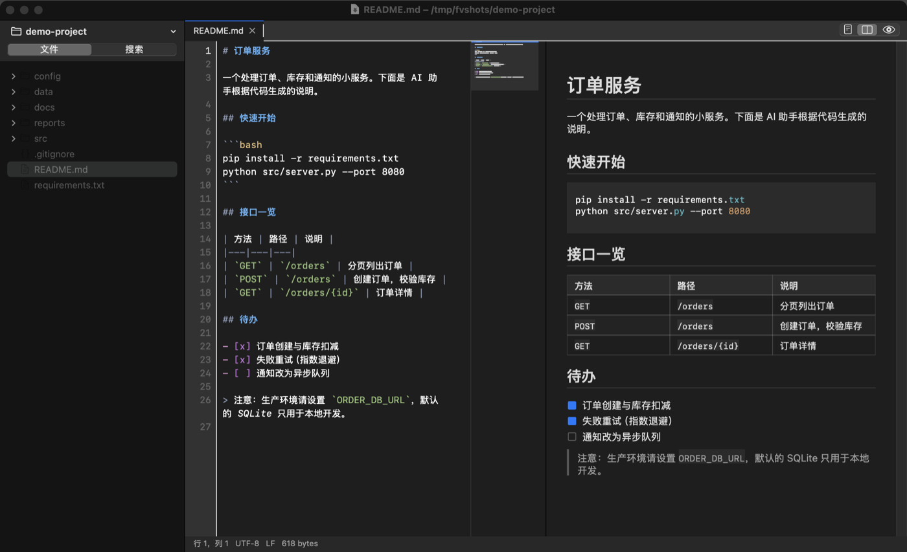
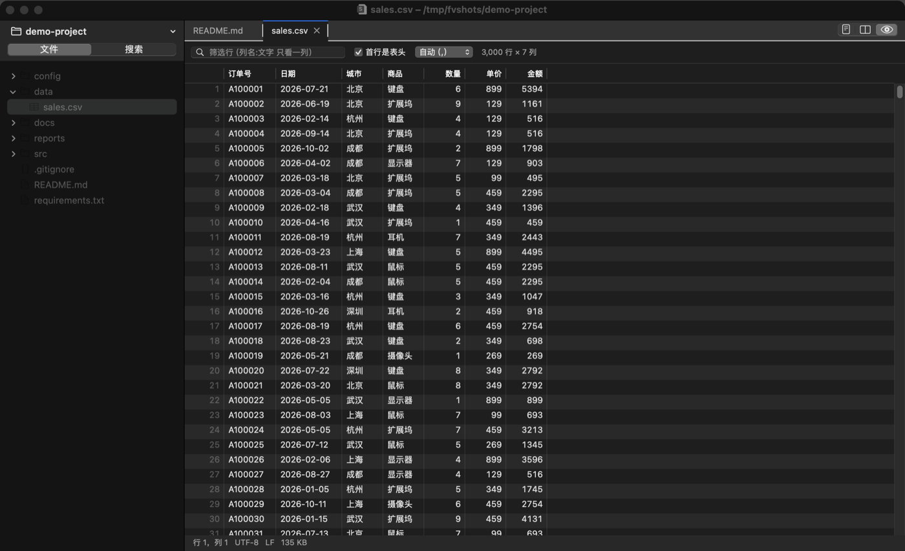
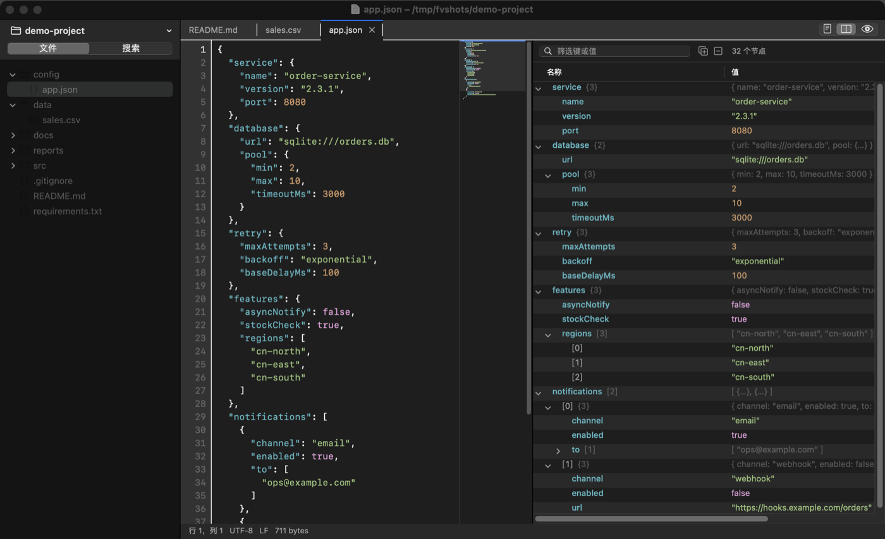

<p align="center"></p>

<h1 align="center">FeatherView</h1>

<p align="center">一个 4 MB 的原生 macOS 应用：浏览工作区、简单编辑、直接预览 Markdown / HTML / 表格 / JSON / 图片 / PDF / 数据库。<br>
不开 IDE，不开浏览器，几十 MB 内存。</p>

<p align="center">
<a href="https://github.com/BradZhone/feather/releases/latest">下载</a> ·
<a href="docs/benchmark.md">资源占用对比</a> ·
<a href="docs/architecture.md">架构</a> ·
<a href="CHANGELOG.md">更新记录</a>
</p>

---

## 为什么做它

开发时内存总是不够：IDE、浏览器、Docker、几个终端，再加上 AI 助手，16 GB 很快就满了。可很多时候我只是想**看一眼**或者**改两行**：

- AI 生成了一个 HTML 报告 / 原型页面，想马上看效果，却要再开一个浏览器窗口（或者再起一个本地服务）。
- AI 写了一份 Markdown 方案，想看排版后的样子，而不是满屏 `**` 和 `#`。
- 改一个配置文件、看一段日志、翻一下 CSV 和 JSON，为此启动 VS Code 要占 500 MB 以上，启动 Zed 也要一两百 MB。
- 不同的文件要用不同的应用：文本编辑器、浏览器、预览、表格软件、数据库客户端、解压工具……

FeatherView 把这些“看和简单改”的需求放进一个原生窗口：左边是工作区文件树，右边按文件类型显示最合适的视图，需要时直接编辑保存。

同一个工作区、同样的文件，实测内存（[完整数据和方法](docs/benchmark.md)）：

| 场景 | FeatherView | VS Code | Zed | Chrome |
|---|---|---|---|---|
| 只打开工作区 | **22 MB** | 535 MB | 109 MB | — |
| 打开源码、Markdown、JSON、2 万行 CSV | **67 MB** | 706 MB | 121 MB | — |
| 打开 50 MB 日志 | **41 MB** | 716 MB | 255 MB | — |
| 查看一个 AI 生成的 HTML 报告 | **92 MB** | — | — | 194 MB |
| 安装体积 | **4 MB** | 659 MB | 176 MB | 1.4 GB |

<sub>Apple M4 / 16 GB / macOS 15.5，3 次运行取中位数，内存为活动监视器“内存”列（phys_footprint）对整棵进程树求和。VS Code 1.107.1、Zed 1.26.2 均为全新配置、无扩展；FeatherView 不提供语言服务器等功能，这是“只看和简单改”时的代价对比。</sub>

## 截图

Markdown 源码与预览并排：



CSV 直接显示为表格，可排序、筛选：



JSON 源码与可折叠的树：



## 适合的场景

- **内存紧张的开发机**：主力 IDE 负责写代码和调试，FeatherView 负责其余的“打开看看”。
- **查看 AI 的产出**：HTML 页面直接渲染（带脚本和样式，跟随深色模式），Markdown 原生排版，Notebook 显示单元格和输出图表，生成的 CSV / JSON 用表格和树查看。
- **改配置、写笔记**：yaml / toml / json / .env / Dockerfile / shell 都有语法高亮；⌘N 新建的草稿不用先选保存位置。
- **查日志**：几百 MB 的日志也能秒开（文件映射进内存，不复制），自动换行、跳行、查找。
- **看数据**：CSV / TSV / JSON Lines 是可排序、可筛选的表格；SQLite 只读浏览并能执行查询；plist（含二进制）和 JSON 是可折叠的树。
- **审阅代码和文档**：文件树、⌘P 快速打开、⇧⌘F 全工作区搜索（内容 / 文件名，正则、全词、包含排除路径）。
- **代替一堆“打开方式”**：图片、SVG、PDF、压缩包、二进制文件都能在同一个窗口里看；也可以设为某些类型的默认打开方式。

它**不是** IDE：没有语言服务器、调试器、Git 界面和插件系统。需要这些的时候，用你的 IDE。

## 功能

| 类型 | 能做什么 |
|---|---|
| 代码 / 文本 | 编辑、撤销重做、查找替换、跳行、自动换行（随窗口宽度，中文按字断行）、小地图、40+ 种语言高亮、UTF-8 / UTF-16 / GB18030、CRLF 保持不变 |
| Markdown | 原生渲染（表格、任务列表、代码高亮、图片、徽章），源码 / 并排 / 预览三种布局，滚动同步 |
| HTML | WebKit 渲染，支持脚本和本地资源，可并排看源码 |
| CSV / TSV / JSON Lines | 表格：排序、按列筛选、复制为 TSV、双击跳回源码；50 万行以内 |
| JSON / plist / Notebook | 可折叠树（保留键顺序、显示路径和行号）；.ipynb 渲染单元格与输出 |
| 图片 / SVG / PDF | 缩放、旋转；SVG 矢量渲染；PDF 缩略图、双页、查找 |
| SQLite | 只读浏览表和视图、看结构、执行 SQL |
| 压缩包 | zip / tar.gz / 7z / rar / jar / apk / whl / deb / iso 等，列出内容，双击解压并打开单个文件 |
| 其他 | 十六进制查看、Quick Look 兜底；文件树多选批量操作；未命名草稿；会话恢复；浅色 / 深色 / 跟随系统；自动保存 |

## 安装

**下载**：在 [Releases](https://github.com/BradZhone/feather/releases/latest) 下载 `FeatherView-<版本>-macos-universal.zip`（Apple 芯片和 Intel 通用），解压后把 FeatherView.app 拖进“应用程序”。

应用是 ad-hoc 签名、未经 Apple 公证，第一次打开会被 Gatekeeper 拦下。任选一种方式放行：

- 在访达里按住 Control 点按 FeatherView → 打开 → 打开；或者
- 系统设置 → 隐私与安全性 → 仍要打开；或者
- 终端执行 `xattr -dr com.apple.quarantine /Applications/FeatherView.app`

**从源码构建**（需要 Xcode Command Line Tools）：

```bash
git clone https://github.com/BradZhone/feather.git
cd feather
make install        # 构建并安装到 /Applications（不可写时为 ~/Applications）
```

系统要求：macOS 12 或更高版本。可选安装 [ripgrep](https://github.com/BurntSushi/ripgrep)，内容搜索会更快。

## 常用快捷键

| 操作 | 快捷键 | 操作 | 快捷键 |
|---|---|---|---|
| 打开文件夹 | ⌘O | 快速打开文件 | ⌘P |
| 切换工作区 | ⌃R | 在工作区中搜索 | ⇧⌘F |
| 新建文档（草稿） | ⌘N | 查找 / 查找替换 | ⌘F / ⌥⌘F |
| 保存 / 全部保存 | ⌘S / ⌥⌘S | 跳到行 | ⌘L |
| 关闭 / 重新打开标签页 | ⌘W / ⇧⌘T | 预览 / 并排预览 | ⇧⌘V / ⌥⌘V |
| 自动换行 | ⌥Z | 小地图 | ⌥⌘M |
| 显示隐藏文件 | ⇧⌘. | 放大 / 缩小 / 还原 | ⌘= / ⌘- / ⌘0 |
| 作为文本 / 十六进制打开 | ⌥⌘1 / ⌥⌘2 | 设置 | ⌘, |

## 设置

⌘, 打开设置：外观（浅色 / 深色 / 跟随系统）、是否显示隐藏文件、始终隐藏的名字（如 `.git`、`.DS_Store`，支持通配符）、搜索时跳过的文件夹（如 `node_modules`）、是否遵守 `.gitignore`、自动保存方式、自动换行、小地图。

“FeatherView → 默认打开方式…”可以把 Markdown、代码、JSON、图片等类型的双击打开交给 FeatherView，取消勾选会还给原来的应用。安装本身不会改变任何文件的默认应用。

## 项目结构

```
src/App       窗口、菜单、标签页与文档管理、设置
src/Editor    文本缓冲区（piece table）与编辑器视图、语法高亮
src/Files     文件树、遍历过滤、文件操作、类型识别
src/Search    工作区搜索、快速打开
src/Preview   Markdown / HTML / 表格 / 树 / Notebook
src/Viewers   图片、SVG、PDF、十六进制、SQLite、压缩包
tests/        逻辑、Markdown、真实视图三组测试
scripts/      安装、发布、资源占用对比
```

设计取舍见 [docs/architecture.md](docs/architecture.md)，开发约定见 [CONTRIBUTING.md](CONTRIBUTING.md)。

## 已知限制

- 未公证，首次打开需要手动放行（见上文）。
- 没有语言服务器（跳转定义、补全、诊断）和 Git 集成。
- 单行超过 32 KB 的部分不显示（极端的压缩代码）；超过 100 万行或 32 MB 的文件不自动换行。
- `.html` 不能设为默认打开方式：macOS 把它交给默认浏览器管理。

## 许可

[MIT](LICENSE) © 2026 BradZhone
