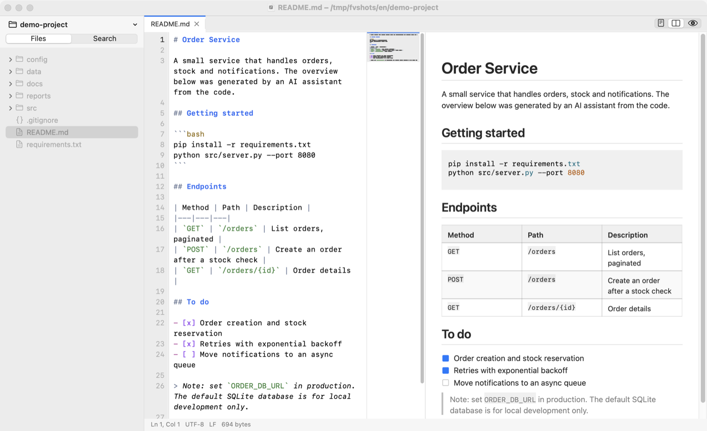
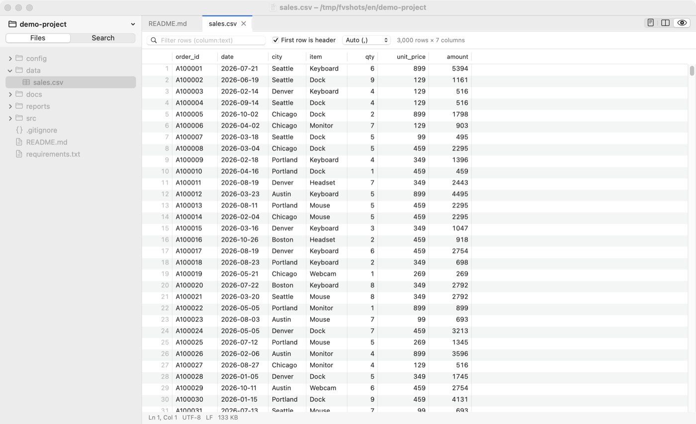
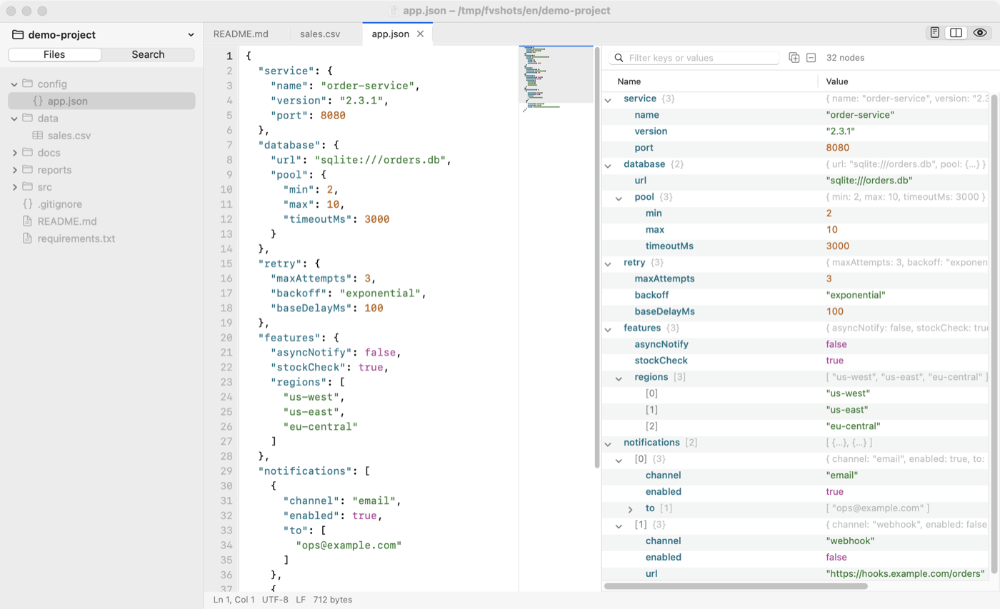
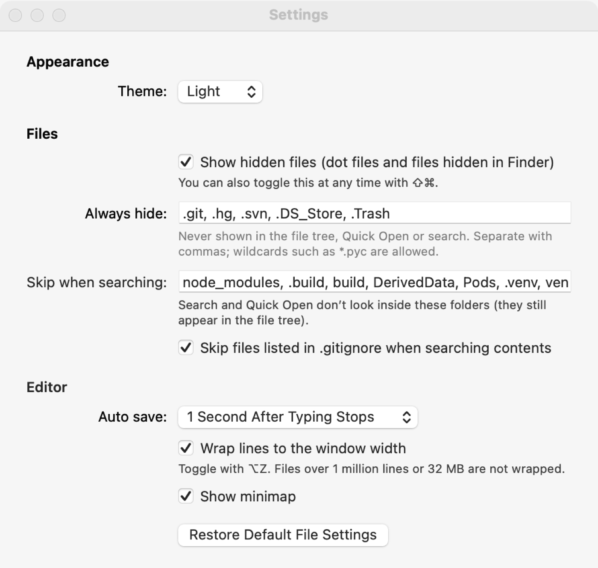

<p align="center"></p>

<h1 align="center">FeatherView</h1>

<p align="center">
A lightweight native macOS workspace for viewing and editing files.<br>
Browse a project, preview Markdown, HTML, tables, JSON, images, PDFs and databases, and make quick edits — in tens of megabytes of memory.
</p>

<p align="center">
<a href="https://github.com/BradZhone/feather/releases/latest">Download</a> ·
<a href="docs/benchmark.md">Benchmark</a> ·
<a href="docs/architecture.md">Architecture</a> ·
<a href="CHANGELOG.md">Changelog</a> ·
<a href="README.zh-Hans.md">简体中文</a>
</p>

<p align="center">


</p>

---

## Overview

A typical development machine runs an IDE, a browser, containers, several terminals and, increasingly, AI assistants. Memory runs out quickly, yet much of the remaining work is simply *looking at files*: reading an AI-generated report, checking a configuration file, skimming a log, inspecting a CSV export. Each of these usually means launching another heavyweight application, such as a second IDE window, a browser tab, a spreadsheet program or a database client.

FeatherView handles that work in a single native window. A file tree on the left lists the workspace; the right side shows each file in the most useful form (a rendered page, a sortable table, a collapsible tree, an image, a PDF) with the source one keystroke away for editing. It is written in Objective-C on AppKit with no third-party dependencies, ships as a 4 MB universal binary, and typically uses 20–70 MB of memory.

FeatherView is not an IDE. It deliberately omits language servers, debuggers, Git integration and plugins, and is designed to complement a full IDE rather than replace one.

## Resource usage

Measured on the same workspace with the same files; median of three runs. Memory is the physical footprint shown in Activity Monitor, summed over each application's processes. See [docs/benchmark.md](docs/benchmark.md) for the method, raw data and caveats.

| Scenario | FeatherView | VS Code | Zed | Chrome |
|---|---:|---:|---:|---:|
| Workspace open, no files | **22 MB** | 535 MB | 109 MB | — |
| Source file, Markdown, JSON and a 20,000-row CSV | **67 MB** | 706 MB | 121 MB | — |
| 50 MB log file | **41 MB** | 716 MB | 255 MB | — |
| AI-generated HTML report | **92 MB** | — | — | 194 MB |
| Application size | **4 MB** | 659 MB | 176 MB | 1.4 GB |

<sub>Apple M4, 16 GB, macOS 15.5. FeatherView 0.15.0; VS Code 1.107.1 and Zed 1.26.2 with fresh profiles and no extensions; Chrome 157. The comparison reflects the cost of viewing and light editing. VS Code and Zed provide substantially more functionality.</sub>

## Screenshots

| Markdown source and preview, side by side | CSV as a sortable, filterable table |
|---|---|
|  |  |
| **JSON source with a collapsible tree** | **Settings** |
|  |  |

## Use cases

- **Development on memory-constrained machines.** Keep the IDE for writing and debugging code; use FeatherView for everything that only needs to be opened and read.
- **Reviewing AI-generated output.** HTML pages render with their styles and scripts, following the system's dark mode. Markdown is typeset natively, Jupyter notebooks show cells and outputs, and generated CSV or JSON files open as tables and trees.
- **Configuration and notes.** YAML, TOML, JSON, `.env`, Dockerfiles and shell scripts are syntax-highlighted. New documents (⌘N) can be written before choosing where to save them.
- **Log inspection.** Files of hundreds of megabytes open immediately because they are memory-mapped rather than copied; soft wrap, go-to-line and find work at that scale.
- **Data inspection.** CSV, TSV and JSON Lines become sortable, filterable tables; SQLite databases can be browsed and queried read-only; property lists (including binary ones) and JSON become collapsible trees.
- **Code and document review.** A file tree, Quick Open (⌘P) and workspace search (⇧⌘F) covering file names and contents, with regular expressions, whole-word matching and include/exclude scopes.
- **One viewer for many formats.** Images, SVG, PDF, archives and binary files are shown in the same window. FeatherView can optionally be made the default app for selected file types.

## Features

| Area | Capabilities |
|---|---|
| Text and code | Editing with undo/redo, find and replace, go to line; multiple cursors (⌥-click, ⌘D, ⇧⌘L, column selection) and line commands (move, copy, delete, join, sort, comment); auto-closed brackets and quotes, bracket matching; soft wrap that follows the window width (word-aware, CJK-aware, indentation-preserving); minimap; highlighting for more than 40 languages; UTF-8, UTF-16, GB18030, Big5, Shift-JIS, EUC-KR and Windows-1252 detected and saved back unchanged; CRLF line endings preserved; Unicode-aware find |
| Markdown | Native rendering (tables, task lists, highlighted code, images, badges); source, side-by-side and preview layouts with synchronized scrolling |
| HTML | WebKit rendering with scripts and local resources; side-by-side source view |
| CSV, TSV, JSON Lines | Table view with sorting, per-column filtering, copy as TSV and jump to source; up to 500,000 rows |
| JSON, plist, notebooks | Collapsible tree preserving key order, with paths and line numbers; `.ipynb` cells and outputs rendered |
| Images, SVG, PDF | Zoom and rotation; vector SVG rendering; PDF thumbnails, two-page layout and search |
| Excel | Spreadsheet view with formats, styles, merged cells, frozen panes and sheet tabs; editing that writes back only the changed cells |
| Word | Page view from the system's Office renderer, with zoom and find; read-only, with "Open in Pages / Word" |
| SQLite | Read-only browsing of tables and views, schema display, ad-hoc SQL queries |
| Archives | Listing of zip, tar.gz, 7z, rar, jar, apk, whl, deb, iso and other formats; double-click to extract and open a single entry |
| Workspace | File tree that follows changes made outside the app, multi-selection and batch operations, drag and drop, untitled drafts, session restore, light/dark/system appearance, auto-save |
| Languages | English and Simplified Chinese, selected automatically from the system language |

## Installation

### Download

Download `FeatherView-<version>-macos-universal.zip` from [Releases](https://github.com/BradZhone/feather/releases/latest). It runs natively on Apple silicon and Intel Macs. Unzip it and move **FeatherView.app** to the Applications folder.

The application is ad-hoc signed and not notarized by Apple, so Gatekeeper blocks the first launch. Allow it once using any of the following:

- In Finder, Control-click FeatherView and choose **Open**, then **Open** again.
- Open **System Settings → Privacy & Security** and click **Open Anyway**.
- Run `xattr -dr com.apple.quarantine /Applications/FeatherView.app` in Terminal.

### Build from source

Requires the Xcode Command Line Tools (`xcode-select --install`).

```bash
git clone https://github.com/BradZhone/feather.git
cd feather
make install        # builds and installs to /Applications, or ~/Applications if that is not writable
```

FeatherView requires macOS 12 or later. Installing [ripgrep](https://github.com/BurntSushi/ripgrep) is optional and speeds up content search.

## Usage

Open a folder with **File → Open Folder…** (⌘O), by dropping it on the Dock icon or the window, or from the command line:

```bash
open -a FeatherView ~/projects/my-app
/Applications/FeatherView.app/Contents/MacOS/FeatherView ~/projects/my-app --open README.md --open data.csv
```

Each file opens in the view that suits it. Use **View → Preview** (⇧⌘V), **Side-by-Side Preview** (⌥⌘V) or **Source Only** to switch between the rendered and source forms of Markdown, HTML, tables and JSON.

### Keyboard shortcuts

| Action | Shortcut | Action | Shortcut |
|---|---|---|---|
| Open folder | ⌘O | Quick Open | ⌘P |
| Switch workspace | ⌃R | Search in workspace | ⇧⌘F |
| New document (draft) | ⌘N | Find / Find and replace | ⌘F / ⌥⌘F |
| Save / Save all | ⌘S / ⌥⌘S | Go to line | ⌘L |
| Close tab / Reopen closed tab | ⌘W / ⇧⌘T | Preview / Side-by-side preview | ⇧⌘V / ⌥⌘V |
| Word wrap | ⌥⌘Z | Minimap | ⌥⌘M |
| Add next occurrence / select all | ⌘D / ⇧⌘L | Add cursor above / below | ⌥⌘↑ / ⌥⌘↓ |
| Move line up / down | ⌥↑ / ⌥↓ | Copy line up / down | ⇧⌥↑ / ⇧⌥↓ |
| Delete line | ⇧⌘K | Toggle line comment | ⌘/ |
| Show hidden files | ⇧⌘. | Zoom in / out / reset | ⌘= / ⌘- / ⌘0 |
| Open as text / hex | ⌥⌘1 / ⌥⌘2 | Settings | ⌘, |

## Configuration

**Settings** (⌘,) controls the appearance (light, dark or system), whether hidden files are shown, names that are always hidden (for example `.git` and `.DS_Store`, wildcards allowed), folders skipped by search (for example `node_modules`), whether `.gitignore` is respected, auto-save, word wrap, the minimap, auto-closing of brackets and quotes, and whether the Markdown preview loads images from the web.

**FeatherView → Default Apps…** lets you choose which file types open in FeatherView when double-clicked in Finder; deselecting a type restores the previous application. Installing FeatherView never changes a default by itself.

**Language.** FeatherView follows the language order in **System Settings → General → Language & Region**. To use a different language for FeatherView only, add it under **Applications** on the same page.

## Project structure

```
src/Support   Localization
src/App       Application delegate, window, menus, tabs and document management, settings
src/Editor    Text buffer (piece table), editor view, syntax highlighting
src/Files     File tree, folder watching, traversal and filtering, file operations, type detection
src/Search    Workspace search, Quick Open
src/Preview   Markdown, HTML, table, tree and notebook views; the Excel workbook model
src/Viewers   Image, SVG, PDF, hex, SQLite, archive, spreadsheet and Word viewers
Resources     Localized strings (en, zh-Hans)
tests         Logic, Markdown and live-view test suites
scripts       Installation, release packaging, benchmark, localization check
```

Design decisions are described in [docs/architecture.md](docs/architecture.md). Development conventions, including how to add or change user-facing text, are in [CONTRIBUTING.md](CONTRIBUTING.md).

## Limitations

- The application is not notarized; the first launch must be allowed manually (see [Installation](#installation)).
- There is no language server support (go to definition, completion, diagnostics) and no Git integration.
- Characters beyond 32 KB on a single line are not displayed, though they are kept and edited correctly (an issue only for extreme minified code). Files larger than one million lines or 32 MB are not soft-wrapped.
- `.html` cannot be made the default for FeatherView, because macOS ties it to the default web browser.

## License

FeatherView is released under the [MIT License](LICENSE). Copyright © 2026 BradZhone.
