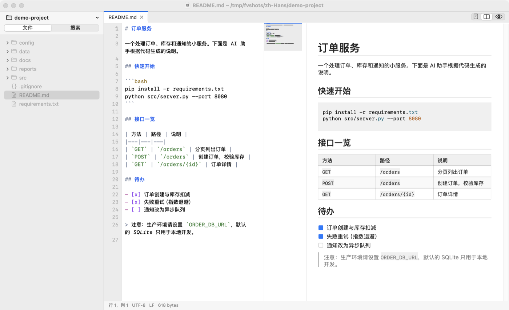
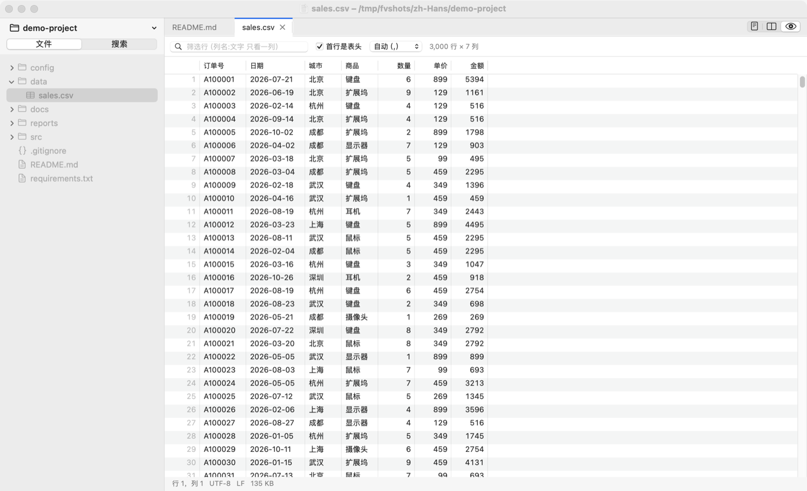
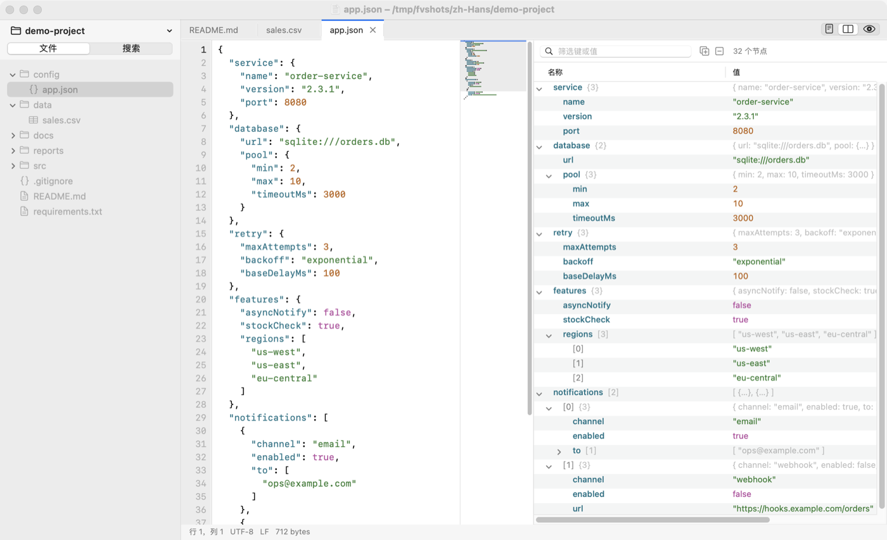
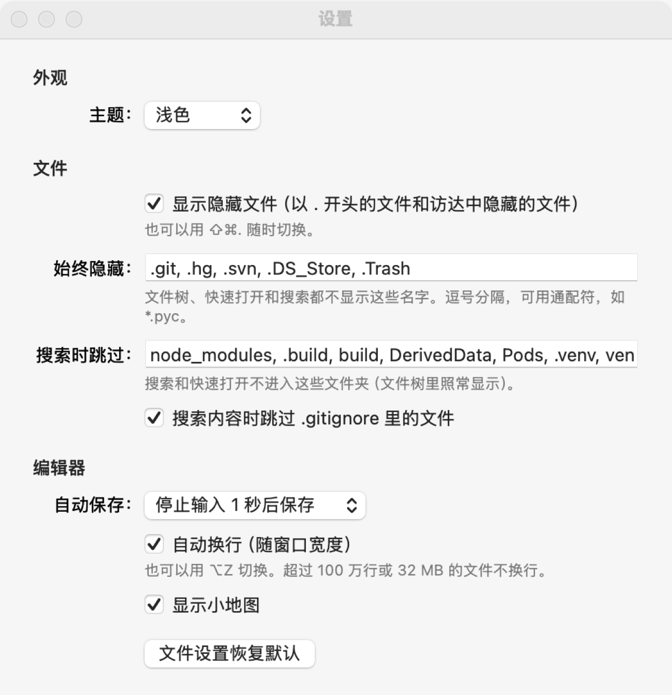

<p align="center"></p>

<h1 align="center">FeatherView</h1>

<p align="center">
轻量的原生 macOS 文件查看与编辑工具。<br>
浏览工作区，预览 Markdown、HTML、表格、JSON、图片、PDF 和数据库，并进行简单编辑，内存占用仅数十 MB。
</p>

<p align="center">
<a href="https://github.com/BradZhone/feather/releases/latest">下载</a> ·
<a href="docs/benchmark.zh-Hans.md">资源占用对比</a> ·
<a href="docs/architecture.zh-Hans.md">架构说明</a> ·
<a href="CHANGELOG.md">更新记录</a> ·
<a href="README.md">English</a>
</p>

<p align="center">


</p>

---

## 概述

开发环境通常同时运行着 IDE、浏览器、容器、多个终端，以及越来越多的 AI 助手，内存很快就会耗尽。然而在这之外，相当一部分工作只是**查看文件**：阅读 AI 生成的报告、核对配置文件、浏览日志、检查导出的 CSV。完成这些任务往往需要再启动一个重量级应用，例如另一个 IDE 窗口、浏览器标签页、表格软件或数据库客户端。

FeatherView 在一个原生窗口中完成这类工作。左侧文件树列出工作区内容，右侧按文件类型以最合适的形式呈现：渲染后的页面、可排序的表格、可折叠的树、图片或 PDF；需要修改时，一个快捷键即可切换到源码进行编辑。FeatherView 基于 AppKit、使用 Objective-C 编写，无第三方依赖，通用二进制安装包约 4 MB，内存占用通常为 20–70 MB。

FeatherView 不是 IDE。它有意不提供语言服务器、调试器、Git 集成和插件系统，定位是与完整 IDE 配合使用，而非取而代之。

## 资源占用

在同一工作区、打开相同文件的条件下测量，取 3 次运行的中位数。内存为活动监视器“内存”列显示的物理占用（phys_footprint），按应用的全部进程求和。测量方法、原始数据与注意事项见 [docs/benchmark.zh-Hans.md](docs/benchmark.zh-Hans.md)。

| 场景 | FeatherView | VS Code | Zed | Chrome |
|---|---:|---:|---:|---:|
| 仅打开工作区 | **22 MB** | 535 MB | 109 MB | — |
| 打开源码、Markdown、JSON 和 2 万行 CSV | **67 MB** | 706 MB | 121 MB | — |
| 打开 50 MB 日志 | **41 MB** | 716 MB | 255 MB | — |
| 查看 AI 生成的 HTML 报告 | **92 MB** | — | — | 194 MB |
| 应用体积 | **4 MB** | 659 MB | 176 MB | 1.4 GB |

<sub>测试环境：Apple M4，16 GB，macOS 15.5。FeatherView 0.15.0；VS Code 1.107.1 与 Zed 1.26.2 使用全新配置、未安装扩展；Chrome 157。该对比反映的是“查看与简单编辑”场景下的资源开销，VS Code 与 Zed 提供的功能远多于 FeatherView。</sub>

## 截图

| Markdown 源码与预览并排 | CSV 表格，可排序、可筛选 |
|---|---|
|  |  |
| **JSON 源码与可折叠的树** | **设置** |
|  |  |

## 适用场景

- **内存有限的开发环境**：编写和调试代码仍使用 IDE，只需打开查看的文件交给 FeatherView。
- **查看 AI 生成的内容**：HTML 页面连同样式与脚本直接渲染，并跟随系统深色模式；Markdown 原生排版；Jupyter Notebook 显示单元格与输出；生成的 CSV、JSON 以表格和树形结构呈现。
- **配置文件与笔记**：YAML、TOML、JSON、`.env`、Dockerfile、Shell 脚本均有语法高亮；新建文档（⌘N）可以先编写，稍后再选择保存位置。
- **工作区内的终端**：⌃` 在编辑器下方打开终端面板；终端以登录 shell 运行在工作区或任意文件夹中，可放在面板或标签页，支持颜色、鼠标上报和输入法。
- **日志排查**：数百 MB 的日志文件通过内存映射打开，无需复制，可即时打开；自动换行、跳转到行、查找在此规模下同样可用。
- **数据检查**：CSV、TSV、JSON Lines 显示为可排序、可筛选的表格；SQLite 数据库可只读浏览和查询；属性列表（含二进制格式）与 JSON 显示为可折叠的树。
- **代码与文档审阅**：文件树、快速打开（⌘P）和工作区搜索（⇧⌘F），支持文件名与内容搜索、正则表达式、全词匹配以及包含 / 排除范围。
- **统一的文件查看器**：图片、SVG、PDF、压缩包和二进制文件均可在同一窗口中查看；也可将 FeatherView 设为指定文件类型的默认打开方式。

## 功能

| 类别 | 功能 |
|---|---|
| 文本与代码 | 编辑、撤销与重做、查找替换、跳转到行；多光标（⌥ 点按、⌘D、⇧⌘L、按列选择）与行操作（移动、复制、删除、合并、排序、注释）；括号与引号自动补全、括号匹配；代码折叠、缩进参考线、显示空白字符；随窗口宽度自动换行（按词断行、支持中日韩文字、保留缩进）；小地图；40 余种语言的语法高亮；自动识别 UTF-8、UTF-16、GB18030、Big5、Shift-JIS、EUC-KR、Windows-1252 并按原编码保存；保留 CRLF 换行符；查找支持各种文字的大小写 |
| Markdown | 原生渲染（表格、任务列表、代码高亮、图片、徽章）；源码、并排、预览三种布局，滚动同步 |
| HTML | WebKit 渲染，支持脚本与本地资源；可与源码并排显示 |
| CSV、TSV、JSON Lines | 表格视图：排序、按列筛选、复制为 TSV、跳转到源码；最多 50 万行 |
| JSON、plist、Notebook | 可折叠的树，保留键的顺序，显示路径与行号；渲染 `.ipynb` 的单元格与输出 |
| 图片、SVG、PDF | 缩放与旋转；SVG 矢量渲染；PDF 缩略图、双页显示与查找 |
| Excel | 表格视图，保留格式、样式、合并单元格、冻结窗格和工作表标签；可编辑，只写回改动的单元格 |
| Word | 由系统 Office 渲染器按页面显示，支持缩放和查找；只读，可“在 Pages / Word 中打开” |
| SQLite | 只读浏览表与视图，查看结构，执行 SQL 查询 |
| 压缩包 | 列出 zip、tar.gz、7z、rar、jar、apk、whl、deb、iso 等格式的内容；双击解压并打开单个文件 |
| 工作区 | 文件树随外部修改自动更新、多选与批量操作、拖放打开、未命名草稿、会话恢复、浅色 / 深色 / 跟随系统外观、自动保存 |
| 界面语言 | 英文与简体中文，根据系统语言自动选择 |

## 安装

### 下载安装

从 [Releases](https://github.com/BradZhone/feather/releases/latest) 下载 `FeatherView-<版本>-macos-universal.zip`，该安装包可在 Apple 芯片与 Intel 芯片的 Mac 上原生运行。解压后将 **FeatherView.app** 移至“应用程序”文件夹。

本应用使用 ad-hoc 签名，未经 Apple 公证，首次启动时会被 Gatekeeper 拦截。可通过以下任一方式放行：

- 在访达中按住 Control 键点按 FeatherView，选择“打开”，再次点按“打开”。
- 打开“系统设置 → 隐私与安全性”，点按“仍要打开”。
- 在终端中执行 `xattr -dr com.apple.quarantine /Applications/FeatherView.app`。

### 从源码构建

需要安装 Xcode Command Line Tools（`xcode-select --install`）。

```bash
git clone https://github.com/BradZhone/feather.git
cd feather
make install        # 构建并安装到 /Applications；若该目录不可写，则安装到 ~/Applications
```

FeatherView 需要 macOS 12 或更高版本。可选安装 [ripgrep](https://github.com/BurntSushi/ripgrep)，以提升内容搜索速度。

## 使用

通过“文件 → 打开文件夹…”（⌘O）、将文件夹拖到程序坞图标或窗口上，或在命令行中打开工作区：

```bash
open -a FeatherView ~/projects/my-app
/Applications/FeatherView.app/Contents/MacOS/FeatherView ~/projects/my-app --open README.md --open data.csv
```

文件会以最合适的视图打开。对于 Markdown、HTML、表格和 JSON，可通过“显示 → 预览”（⇧⌘V）、“并排预览”（⌥⌘V）或“仅源码”在渲染结果与源码之间切换。

### 快捷键

| 操作 | 快捷键 | 操作 | 快捷键 |
|---|---|---|---|
| 打开文件夹 | ⌘O | 快速打开 | ⌘P |
| 切换工作区 | ⌃R | 在工作区中搜索 | ⇧⌘F |
| 新建文档（草稿） | ⌘N | 查找 / 查找和替换 | ⌘F / ⌥⌘F |
| 保存 / 全部保存 | ⌘S / ⌥⌘S | 跳到行 | ⌘L |
| 关闭标签页 / 重新打开关闭的标签页 | ⌘W / ⇧⌘T | 预览 / 并排预览 | ⇧⌘V / ⌥⌘V |
| 自动换行 | ⌥⌘Z | 小地图 | ⌥⌘M |
| 添加下一个匹配项 / 选择所有匹配项 | ⌘D / ⇧⌘L | 在上方 / 下方添加光标 | ⌥⌘↑ / ⌥⌘↓ |
| 上移 / 下移行 | ⌥↑ / ⌥↓ | 向上 / 向下复制行 | ⇧⌥↑ / ⇧⌥↓ |
| 删除行 | ⇧⌘K | 切换行注释 | ⌘/ |
| 折叠 / 展开 | ⌥⌘[ / ⌥⌘] | 扩大 / 缩小选区 | ⌃⇧⌘→ / ⌃⇧⌘← |
| 显示隐藏文件 | ⇧⌘. | 放大 / 缩小 / 还原 | ⌘= / ⌘- / ⌘0 |
| 作为文本 / 十六进制打开 | ⌥⌘1 / ⌥⌘2 | 设置 | ⌘, |

## 配置

**设置**（⌘,）包括：外观（浅色、深色或跟随系统）、是否显示隐藏文件、始终隐藏的名称（如 `.git`、`.DS_Store`，支持通配符）、搜索时跳过的文件夹（如 `node_modules`）、是否遵循 `.gitignore`、自动保存、自动换行、小地图、括号与引号自动补全，以及 Markdown 预览是否加载网络图片。

**FeatherView → 默认打开方式…** 用于选择在访达中双击时由 FeatherView 打开的文件类型；取消勾选会恢复原来的应用。安装 FeatherView 本身不会更改任何文件类型的默认应用。

**界面语言**：FeatherView 遵循“系统设置 → 通用 → 语言与地区”中的语言顺序。如需仅为 FeatherView 指定其他语言，可在同一页面的“应用程序”中添加。

## 项目结构

```
src/Support   本地化
src/App       应用入口、窗口、菜单、标签页与文档管理、设置
src/Editor    文本缓冲区（piece table）、编辑器视图、语法高亮
src/Files     文件树、文件夹监视、遍历与过滤、文件操作、类型识别
src/Search    工作区搜索、快速打开
src/Preview   Markdown、HTML、表格、树形与 Notebook 视图；Excel 工作簿模型
src/Viewers   图片、SVG、PDF、十六进制、SQLite、压缩包、电子表格与 Word 查看器
Resources     界面文字的翻译（en、zh-Hans）
tests         逻辑、Markdown 与真实视图三组测试
scripts       安装、发布打包、资源占用对比、本地化检查
```

设计取舍见 [docs/architecture.zh-Hans.md](docs/architecture.zh-Hans.md)；开发约定（包括如何新增或修改界面文字）见 [CONTRIBUTING.zh-Hans.md](CONTRIBUTING.zh-Hans.md)。

## 已知限制

- 应用未经公证，首次启动需要手动放行（见[安装](#安装)）。
- 不提供语言服务器功能（跳转到定义、补全、诊断），也没有 Git 集成。
- 单行超过 32 KB 的部分不显示，但会被完整保留并能正确编辑（仅影响极端的压缩代码）；超过 100 万行或 32 MB 的文件不自动换行。
- 无法将 `.html` 的默认打开方式设为 FeatherView，因为 macOS 将其交由默认浏览器管理。

## 许可证

FeatherView 以 [MIT 许可证](LICENSE) 发布。Copyright © 2026 BradZhone.
